<div align="center">

# 🏗️ NIRIKSHAN

### AI-assisted visual deterioration monitoring and inspection prioritisation for ageing buildings

[](https://www.python.org/)
[](https://fastapi.tiangolo.com/)
[](https://opencv.org/)
[](https://www.sqlite.org/)
[](https://developer.mozilla.org/docs/Web/JavaScript)
[](#testing)
[](LICENSE)

**A local-first civic-tech prototype that compares repeat building photographs, highlights visible deterioration over time, and helps engineers decide what to review first.**

[Overview](#overview) · [Features](#key-features) · [Quick Start](#quick-start) · [Demo](#demo-workflow) · [Architecture](#architecture) · [Safety](#safety--scope) · [License](#license)

</div>

---

## Overview

**NIRIKSHAN** is an engineer-assist platform for longitudinal visual monitoring of ageing buildings.

Instead of treating every visible crack as an emergency, NIRIKSHAN keeps a structured history of the same building areas over time and asks a more useful question:

> **Which monitored areas are showing enough visible change to deserve engineering attention first?**

The system is designed around repeat smartphone imagery and a transparent review workflow:

1. register an identifiable building;
2. store basic structural context;
3. select a simple inspection area such as a balcony, wall, beam or column;
4. record the first photograph automatically as the starting visual record;
5. return later and photograph the same area again;
6. align the images and compare visible crack-like evidence;
7. calculate an **Inspection Priority** using accumulated evidence;
8. send reliable comparisons to an engineer review queue.

NIRIKSHAN does **not** declare buildings safe or unsafe, predict collapse, or infer structural strength from a photograph.

---

## Why NIRIKSHAN?

Periodic building inspections create a practical gap: visible conditions can change between formal visits, while engineers cannot repeatedly inspect every ageing property at high frequency.

NIRIKSHAN is designed to support that gap by creating a **consistent visual timeline** and making change easier to review.

The core idea is deliberately simple:

```text
FIRST VISIT
    ↓
Record building + inspection area
    ↓
Take first photo
    ↓
Saved automatically as trusted reference

LATER VISIT
    ↓
Take new photo of same area
    ↓
Align images
    ↓
Measure visible change
    ↓
Accumulate evidence
    ↓
Inspection Priority
    ↓
Engineer review
```

---

## Key Features

### 🏢 Identifiable building records

Building registration supports:

- building / society name;
- address and locality validation;
- optional 6-digit PIN code;
- Mumbai ward;
- optional browser GPS coordinates;
- nearby registered-building lookup.

GPS is used as **supporting location evidence**, not as a claim that the exact building can always be identified automatically in a dense urban area.

### 🧱 Structural Context Profile

Each building can store verified or user-entered context including:

- structure type:
  - RCC framed structure;
  - load-bearing masonry;
  - steel structure;
  - composite / mixed;
  - unknown;
- number of floors;
- approximate age;
- primary construction material;
- previous structural repairs;
- previous engineer assessment;
- optional verified structural / test information.

If no verified structural test information exists, the application displays:

> **Structural strength: Not assessed**

NIRIKSHAN never fabricates concrete grade, reinforcement details, load capacity or structural strength from an image.

### 📍 Simple inspection areas

Users do not need technical labels such as “North facade panel A”. They choose familiar building elements:

- Building exterior / facade
- Balcony
- Column
- Beam
- Slab / Chajja
- Structural wall
- Partition / plaster wall
- Staircase exterior
- Other

A floor and short description can be added, for example:

```text
Balcony · 3rd floor · Near flat 302
```

### 📸 Automatic first-photo reference

The first accepted image for an inspection area becomes the starting visual record automatically.

Users do not need to understand internal terms such as *baseline*, *capture point* or *homography*.

### 🔍 Repeat-image comparison

For later visits, NIRIKSHAN:

- checks image quality;
- aligns the new image with the trusted reference;
- normalises illumination;
- identifies crack-like visual candidates;
- counts independent new regions;
- compares against the first accepted image and latest accepted visit;
- visualises the evidence in before / after / change views.

### 🧠 Evidence-accumulation priority scoring

One tiny crack does **not** automatically mean a building needs urgent review.

The current prototype combines three groups of evidence:

| Component | Weight | Purpose |
|---|---:|---|
| **Visible progression** | 55% | How much comparable visual evidence has changed |
| **Damage pattern** | 30% | Multiple regions, repeated progression and evidence accumulation |
| **Structural context** | 15% | Element type and verified building context used to adjust review order |

Typical behaviour:

| Observed pattern | Priority behaviour |
|---|---|
| One small isolated crack-like region | Routine monitoring |
| One unchanged region on a later visit | Routine monitoring |
| A few small regions with little progression | Routine / low |
| Multiple new regions in the same area | Review recommended |
| Several regions with strong progression | High priority |
| Repeated strong progression on important elements | High / urgent human review |

A single severe-looking change on a column, beam, slab or structural wall can request human review, but **one isolated candidate region cannot jump directly to High or Urgent by itself**.

### 🏗️ Building-level priority

NIRIKSHAN does not treat one photograph as an assessment of the entire building.

Each monitored area keeps its own latest reliable result. The building-level priority is driven by the area currently requiring the most attention.

Example:

```text
Raghunath House

Ground-floor plaster wall     Routine
3rd-floor balcony             Routine
Rear structural wall          Review recommended
Entrance column               High

Overall inspection priority: HIGH
Priority driver: Entrance column
```

This means the building should appear higher in the review queue because of that monitored area. It does **not** mean the complete building has been structurally assessed.

### 👷 Human-in-the-loop review

An engineer can review the evidence and mark an inspection as:

- **Confirmed**
- **False alarm**
- **Needs site visit**

Every result keeps its inspection ID, timestamp and evidence trail.

### 🔐 Practical safeguards

The prototype includes:

- HTTP Basic authentication for UI, API and evidence files;
- optional local auth bypass for isolated development;
- upload type and size validation;
- duplicate-image rejection;
- low-confidence comparison quarantine;
- trusted-reference protection so failed captures do not poison future comparisons;
- HTML escaping for server-supplied values;
- archived queue deletion instead of destructive evidence removal.

---

## Architecture

```mermaid
flowchart LR
    A[Building Registration] --> B[Structural Context]
    B --> C[Inspection Area]
    C --> D[First Photo]
    D --> E[Trusted Visual Record]
    E --> F[Repeat Visit]
    F --> G[Image Quality Check]
    G --> H[Image Alignment]
    H --> I[Illumination Normalisation]
    I --> J[Crack-like Candidate Segmentation]
    J --> K[Region + Progression Analysis]
    K --> L[Inspection Priority]
    L --> M[Engineer Review Queue]
    M --> N[Confirmed / False Alarm / Site Visit]
```



### Current stack

| Layer | Technology |
|---|---|
| Backend | FastAPI |
| Frontend | HTML, CSS, Vanilla JavaScript |
| Computer Vision | OpenCV + NumPy |
| Image handling | Pillow |
| Database | SQLite |
| Testing | Pytest + HTTPX |
| Server | Uvicorn |

---

## AI & Engineering Pipeline

NIRIKSHAN is designed as an **engineering decision-support system**, not a single black-box AI model. The prototype combines image processing, geometric registration, visible-damage analysis, longitudinal comparison, structural context and transparent prioritisation.

The current repository deliberately separates **what works today** from **what is planned for the trained-ML stage**.

### 1. Current computer-vision stack

The runnable prototype currently uses a **classical computer-vision baseline** so the complete monitoring workflow can be demonstrated end-to-end without pretending that a trained production model already exists.

```text
SMARTPHONE IMAGE
      ↓
Image quality checks
      ↓
Illumination normalisation
      ↓
ORB keypoint detection + descriptor matching
      ↓
RANSAC-filtered geometric correspondences
      ↓
Homography-based image registration
      ↓
Crack-like candidate segmentation
      ↓
Morphological filtering + connected components
      ↓
Independent visible-region analysis
      ↓
Reference + previous-visit comparison
      ↓
Visible progression metrics
```

#### Techniques used today

| Stage | Technique | Why it is used |
|---|---|---|
| Image quality | Blur, exposure and resolution checks | Reject poor captures before comparison |
| Feature extraction | **ORB** | Fast local features that work without a GPU |
| Match filtering | **RANSAC** | Remove bad feature matches before alignment |
| Registration | **Homography** | Align approximately planar building surfaces between visits |
| Normalisation | Intensity / illumination normalisation | Reduce false change caused by lighting differences |
| Candidate extraction | Classical OpenCV morphology / thresholding | Produce crack-like candidate regions for the MVP |
| Region analysis | Connected components | Count and measure independent visible candidate regions |
| Temporal comparison | Baseline + previous accepted visit | Separate persistent features from newly appearing change |

The main computer-vision logic lives in `app/cv.py`. The module boundary is intentionally kept separate from the API and scoring code so a trained segmentation model can replace the current candidate extractor without rewriting the whole application.

### 2. Decision intelligence

The system does not use `crack detected = dangerous building`. Instead, NIRIKSHAN accumulates evidence over time.

```text
VISIBLE PROGRESSION
        +
NUMBER OF NEW / INDEPENDENT REGIONS
        +
REPEATED CHANGE ACROSS VISITS
        +
TYPE OF BUILDING ELEMENT
        +
VERIFIED STRUCTURAL CONTEXT
        ↓
INSPECTION PRIORITY
        ↓
ENGINEER REVIEW
```

The current prototype groups the priority calculation into:

| Evidence group | Prototype weight | Examples |
|---|---:|---|
| **Visible progression** | 55% | Change in crack-like extent between comparable captures |
| **Damage pattern** | 30% | Multiple regions, new regions, repeated progression |
| **Structural context** | 15% | Column vs plaster wall, structure type, verified repair history |

These are **prototype prioritisation weights**, not structural-design coefficients. They are intended to be calibrated with practising structural engineers before any field use.

A single isolated candidate region is intentionally prevented from jumping directly to **High** or **Urgent** on its own. Multiple independent changes, progression over time and important structural locations contribute more strongly to review priority.

The scoring and evidence-accumulation logic is implemented in `app/scoring.py`.

### 3. Structural-context layer

NIRIKSHAN stores contextual information such as:

- RCC framed, load-bearing masonry, steel, composite or unknown structure type;
- number of floors and approximate age;
- primary construction material;
- previous structural repairs;
- previous engineer assessment;
- optional verified test or strength information.

This information is used only to improve **review ordering**. NIRIKSHAN does not infer concrete grade, reinforcement quantity, load capacity or structural strength from photographs. If verified strength information is not available, the interface explicitly reports **Structural strength: Not assessed**.

### 4. Human-in-the-loop intelligence

Every flagged result is designed to remain explainable. The reviewer can inspect:

- previous image;
- current image;
- aligned comparison;
- highlighted visible-change regions;
- alignment confidence;
- new and existing candidate-region counts;
- contributing priority factors;
- structural context used by the score.

The engineer then records one of three outcomes:

- **Confirmed**
- **False alarm**
- **Needs site visit**

This feedback is stored so it can later support model evaluation and retraining.

### 5. Planned ML / deep-learning stack

The current crack-like segmenter is a classical-CV baseline. The next technical milestone is to replace it with a validated semantic-segmentation model. Candidate architectures include:

| Model | Intended use |
|---|---|
| **U-Net** | Strong baseline for pixel-level crack segmentation |
| **DeepLabV3+** | Multi-scale segmentation of surface deterioration |
| **SegFormer** | Transformer-based segmentation with strong contextual modelling |
| **YOLO Segmentation** | Fast instance / region segmentation for practical deployment |
| **Siamese / learned change-detection network** | Future direct before-vs-after change detection |

Planned training workflow:

```text
Public structural-damage datasets
        +
Locally captured Mumbai imagery
        ↓
Pixel-level annotation masks
        ↓
Train / validation / held-out split
        ↓
Lighting + blur + perspective + compression augmentation
        ↓
Model training / fine-tuning
        ↓
IoU, F1, recall and false-alarm evaluation
        ↓
Integration behind app/cv.py
        ↓
Engineer-reviewed field validation
```

The project roadmap targets roughly **500–1,500 carefully annotated local images** for fine-tuning, subject to data quality and access.

### 6. What is actually “AI” in NIRIKSHAN?

NIRIKSHAN should be described accurately:

- **Today:** intelligent visual monitoring built from computer vision, temporal comparison, structural context and transparent decision logic.
- **Next stage:** trained deep-learning segmentation and learned change detection.
- **Not claimed today:** a validated AI model that can diagnose structural safety or predict collapse.

That distinction is intentional. The goal is to build a system that can be validated honestly rather than label every image-processing step as AI.

### Engineering module map

| File | Responsibility |
|---|---|
| `app/cv.py` | Image quality, alignment, visual candidate extraction and comparison |
| `app/scoring.py` | Evidence accumulation, structural-context weighting and priority bands |
| `app/db.py` | Longitudinal building / inspection history and audit trail |
| `app/main.py` | FastAPI routes, validation and workflow orchestration |
| `scripts/benchmark_controls.py` | Controlled regression benchmark for unchanged / changed pairs |
| `tests/` | API, CV, scoring and regression tests |

> **Important:** current classical-CV and synthetic-benchmark outputs must not be presented as validated real-world structural-damage accuracy.

---

## Demo Workflow

The repository includes a controlled synthetic demonstration pair:

```text
sample_data/demo_baseline.jpg
sample_data/demo_followup.jpg
```

### Recommended live demo

1. Register a demo building.
2. Add its structural context.
3. Create an inspection area such as:

```text
Balcony · 3rd floor · Near flat 302
```

4. Upload `demo_baseline.jpg` as the first inspection photo.
5. Return to the same inspection area.
6. Upload `demo_followup.jpg`.
7. Run the comparison.
8. Open the result from the Engineer Review Queue.
9. Review the before / after / change evidence.
10. Mark the result **Confirmed**, **False alarm**, or **Needs site visit**.

The synthetic demo exists to demonstrate the **workflow and failure handling**, not to claim real-building accuracy.

---

## Quick Start

### Prerequisites

- Python **3.10+**
- pip
- macOS, Linux or Windows

### 1. Clone the repository

```bash
git clone https://github.com/YOUR_USERNAME/NIRIKSHAN.git
cd NIRIKSHAN
```

### 2. Create a virtual environment

#### macOS / Linux

```bash
python3 -m venv .venv
source .venv/bin/activate
```

#### Windows PowerShell

```powershell
python -m venv .venv
.venv\Scripts\Activate.ps1
```

### 3. Install dependencies

```bash
pip install -r requirements.txt
```

### 4. Configure environment variables

Copy the example file:

```bash
cp .env.example .env
```

Recommended local values:

```env
NIRIKSHAN_AUTH_USERNAME=admin
NIRIKSHAN_AUTH_PASSWORD=change-this-password
NIRIKSHAN_AUTH_DISABLED=0
NIRIKSHAN_MAX_UPLOAD_MB=12
NIRIKSHAN_ALIGNMENT_THRESHOLD=0.45
```

For isolated local development only, authentication can be disabled:

```bash
export NIRIKSHAN_AUTH_DISABLED=1
```

### 5. Run NIRIKSHAN

```bash
python3 run.py
```

Open:

```text
http://127.0.0.1:8000
```

---

## Project Structure

```text
NIRIKSHAN/
├── app/
│   ├── main.py              # FastAPI routes and application workflow
│   ├── cv.py                # Image quality, alignment and vision pipeline
│   ├── scoring.py           # Evidence accumulation + priority scoring
│   ├── db.py                # SQLite persistence
│   ├── static/
│   │   ├── app.js           # Frontend behaviour
│   │   └── styles.css       # UI styling
│   └── templates/
│       └── index.html       # Main interface
├── benchmarks/
│   ├── benchmark_latest.csv
│   ├── benchmark_latest.json
│   └── benchmark_latest.md
├── docs/
│   ├── NIRIKSHAN_PRD.pdf
│   ├── NIRIKSHAN_PRD_SOURCE.pdf
│   └── REVIEW_FIXES.md
├── sample_data/
│   ├── demo_baseline.jpg
│   └── demo_followup.jpg
├── scripts/
│   └── benchmark_controls.py
├── tests/
│   ├── test_api.py
│   ├── test_cv.py
│   └── test_scoring.py
├── .env.example
├── .gitignore
├── LICENSE
├── PROJECT_STATUS.md
├── README.md
├── requirements.txt
└── run.py
```

---

## Testing

Run the full automated test suite:

```bash
python3 -m pytest -q
```

Current repository status:

```text
23 passed
```

Tests cover API behaviour, scoring rules, image handling, alignment-related controls, duplicate/reference handling and regression cases.

---

## Synthetic Regression Benchmark

Run:

```bash
python3 scripts/benchmark_controls.py
```

Current controlled benchmark output:

```json
{
  "unchanged_reliable_cases": 12,
  "false_alarm_count": 0,
  "false_alarm_rate": 0.0,
  "changed_reliable_cases": 3,
  "visual_change_detection_recall": 1.0,
  "multi_region_priority_recall": 1.0
}
```

These are **synthetic regression checks from controlled transformations**, not real-world accuracy measurements and should not be presented as field-performance claims.

---

## Environment Variables

| Variable | Default / Example | Purpose |
|---|---|---|
| `NIRIKSHAN_AUTH_USERNAME` | `admin` | Basic-auth username |
| `NIRIKSHAN_AUTH_PASSWORD` | `change-this-password` | Basic-auth password |
| `NIRIKSHAN_AUTH_DISABLED` | `0` | Set to `1` only for isolated local development |
| `NIRIKSHAN_MAX_UPLOAD_MB` | `12` | Maximum image upload size |
| `NIRIKSHAN_ALIGNMENT_THRESHOLD` | `0.45` | Minimum acceptable comparison alignment confidence |

Never commit a real `.env` file or production credentials.

---

## Safety & Scope

NIRIKSHAN is an **inspection-prioritisation prototype**, not a structural certification tool.

It does **not**:

- declare a building safe or unsafe;
- predict collapse probability;
- estimate structural load capacity from images;
- replace a structural engineer;
- assess hidden reinforcement corrosion, foundations or internal structural defects;
- provide emergency-response advice.

The system only ranks **visible change evidence** for human review.

Any operational deployment would require:

- validation on real building imagery;
- practising structural-engineer involvement;
- calibrated thresholds;
- approved inspection procedures;
- privacy and data-governance controls;
- review of applicable legal and civic requirements.

---

## Roadmap

- [x] Building registration and structural context
- [x] Simple inspection-area workflow
- [x] Automatic first-photo reference
- [x] Repeat-image alignment
- [x] Evidence accumulation priority scoring
- [x] Engineer review queue
- [x] Duplicate / quarantine safeguards
- [x] Building-level priority driver
- [x] Synthetic benchmark harness
- [x] Automated regression tests
- [ ] Train a dedicated crack-segmentation model
- [ ] Build a labelled Mumbai-focused validation set
- [ ] Add validated spalling detection
- [ ] Add exposed-reinforcement detection
- [ ] Calibrate scoring with practising structural engineers
- [ ] Evaluate on held-out real building imagery
- [ ] Add richer longitudinal trend visualisation
- [ ] Pilot with consenting property / civic stakeholders

---

## Contributing

Contributions are welcome, especially in:

- structural-damage computer vision;
- image registration;
- false-positive reduction;
- accessibility and field UX;
- privacy-preserving civic technology;
- testing and benchmark design.

A good contribution should preserve NIRIKSHAN's central principle:

> **AI supports engineering attention; it does not replace engineering judgement.**

Before opening a pull request:

```bash
python3 -m pytest -q
```

Please keep safety-sensitive claims conservative and backed by validation.

---

## GitHub Push

After creating an empty GitHub repository named `NIRIKSHAN`:

```bash
git init
git add .
git commit -m "Initial commit: NIRIKSHAN building monitoring prototype"
git branch -M main
git remote add origin https://github.com/YOUR_USERNAME/NIRIKSHAN.git
git push -u origin main
```

---

## License

This project is licensed under the **MIT License**. See [`LICENSE`](LICENSE) for details.

---

<div align="center">

### NIRIKSHAN

**See what changed. Prioritise what needs review.**

Built as an AI-assisted building monitoring prototype for safer, more structured visual inspection workflows.

</div>
